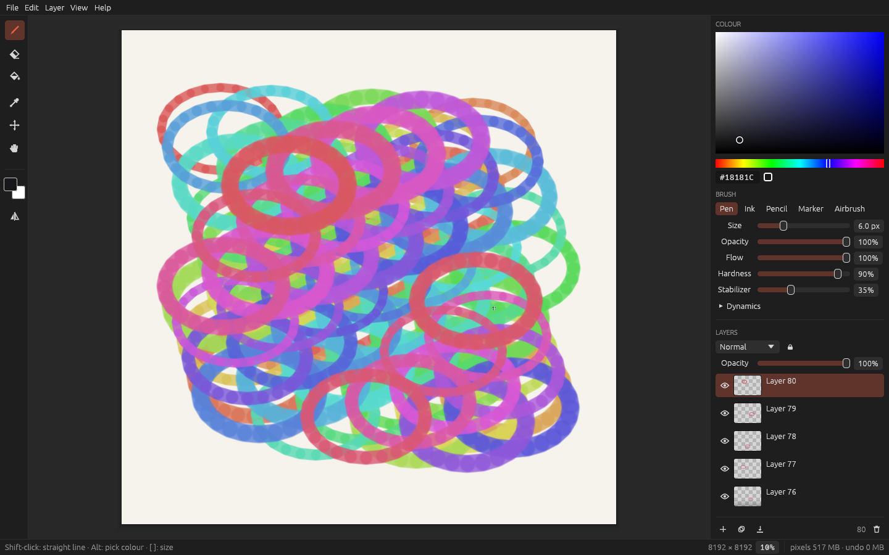

# egaku

*描く: to draw, to paint.*

A minimal, fast raster painting app for desktop, written in Rust.



egaku deliberately does little: brush, eraser, fill, eyedropper, move,
layers, undo. Big canvases and lots of layers are normal here, not
something the app tries to talk you out of. Adding features later is
easier than taking them away, so the work so far went into a core that
stays fast as documents grow.

```bash
cargo run --release              # empty canvas
cargo run --release -- art.ora   # open a file
```

On Linux you need the usual desktop libraries: Wayland or X11,
`libxkbcommon-x11`, and a Vulkan or GL driver.

## Using it

| Input | Action |
|---|---|
| `B` `E` `G` `I` `V` `H` | Brush, Eraser, Fill, Eyedropper, Move, Hand |
| `Space` drag · middle drag · trackpad scroll | Pan |
| mouse wheel · pinch · `Ctrl+Space` drag | Zoom around the cursor |
| `R` drag (`Shift` snaps 15°) | Rotate the view |
| `M` | Mirror the view |
| hold `Alt` | Eyedropper |
| `Shift`+click | Straight line from the end of the last stroke |
| `[` `]` · `Shift+[` `]` · `1`…`0` | Brush size · hardness · opacity |
| `X` / `D` | Swap / reset colours |
| `/` | Lock layer alpha |
| `Ctrl+Z` / `Ctrl+Shift+Z` | Undo / redo |
| `Ctrl+Shift+N` · `Ctrl+J` · `Ctrl+E` | New layer · duplicate · merge down |
| `Ctrl+0` / `Ctrl+1` | Fit / 100% |
| `Tab` · `F11` · `F1` | Hide panels · fullscreen · all shortcuts |

Dropping a `.ora` file on the window opens it. Dropping a PNG, JPEG or
WebP adds it as a new layer, and so does pasting an image.

## Design

Each choice below borrows from something that has worked in graphics
software before.

**Sparse, copy-on-write tiles.** Every layer is a grid of 64×64 tiles, the
same layout Krita and most painting engines use. A tile nobody has
painted doesn't exist. An empty layer on a 16k canvas costs half a megabyte
of pointers instead of a gigabyte of pixels,
so a layer is cheap to add and there's no reason to ration them. Tiles are
reference-counted and copied only when written (`Arc::make_mut`), so
duplicating a layer is instant and costs no memory until you paint on it.

**Undo is a list of snapshots.** Since tiles are shared, a snapshot of the
whole document is just a vector of layer handles. Every operation can be
undone without writing any inverse code, a stroke costs only the tiles it
touched, and finding what changed between two states is a pointer
comparison. History is capped by memory use, not step count, so long
sessions of small edits keep a deep history and huge edits can't exhaust
RAM.

**The brush paints into a mask first.** Dabs go into a 16-bit coverage
mask. Flow sets how much each dab adds, and opacity caps the total (the
Photoshop model). The mask is applied to the layer once, when the stroke
ends. Low-flow airbrushing builds up smoothly instead of banding the way
repeated 8-bit blending does, and each stroke becomes one cheap undo step.
The stabiliser and the shift-click straight line follow SAI and MS Paint.

**Recompositing does only the work that's needed.** The composite is cached
per tile and rebuilt only where something changed, starting with tiles in
the viewport, spread across all cores. During a stroke, everything below
the active layer is flattened once and cached, so painting at the bottom
of a 200-layer stack costs about the same as painting on one layer.

**The display uses a mip pyramid.** The composite has a box-filtered pyramid
of half-size levels, and the GPU only holds 256² textures for the chunks
in view at the level that matches the zoom. A zoomed-out 16k canvas
uploads about a screenful of pixels. Only changed tiles are re-uploaded.
Pan, zoom, rotate and mirror only move vertices, so navigating never
recomposites anything. Pixels show nearest-neighbour above 100% and
filtered below.

**Blending happens in premultiplied sRGB.** That's what artists' eyes are
trained on (Photoshop, SAI, Procreate and Krita all default to it), and
it lets the common Normal mode run as pure integer maths. The other
blend modes follow the W3C compositing spec.

**Files are OpenRaster.** The native format is `.ora`, the open layered
format Krita, GIMP and MyPaint also read and write, so your work isn't
locked into this app. Layers are cropped to their painted area and
encoded in parallel. Saves go to a temporary file and are then renamed
over the original, and they run on a background thread against a
snapshot, so you can keep painting while a large file saves.

**The interface stays neutral.** Grey chrome keeps it from skewing your
colour judgement. Tools spring into place while a key is held (Photoshop),
the view can rotate and mirror (SAI), and the brush and eraser each
remember their own size. 100% zoom means one canvas pixel per physical
screen pixel, even on HiDPI displays. The colour picker works in HSV, so
hue isn't lost when you pass through grey.

## Performance

`cargo run --release -p egaku-core --example bench` builds an 8192² document
with 200 painted layers, then paints on the bottom layer. On a modest
4-core cloud VM:

| | |
|---|---|
| full recomposite, 8192², 200 layers | ~220 ms |
| per-frame update while painting under 199 layers | ~0.5 ms median, ~1.1 ms max |
| committing a stroke | ~3 ms |
| undo + recomposite | ~220 ms |

`--example make_big` writes a large test `.ora` file.

## Layout

- `crates/egaku-core`: document model, tiles, blending, brush engine,
  compositor, undo, fill and file formats. No GUI, fully unit-tested.
- `crates/egaku`: the desktop app (eframe/egui on wgpu).

## Not yet

Left out on purpose for now, roughly in the order they'd come next:

- **Tablet pressure.** Pressure works wherever the windowing layer reports
  pen force (it arrives as touch force). Full Wacom/Windows Ink/macOS
  tablet support needs a dedicated tablet input backend.
- Selections and transforms, layer groups, clipping masks.
- Colour management and higher bit depths.
- Crash recovery and autosave.
